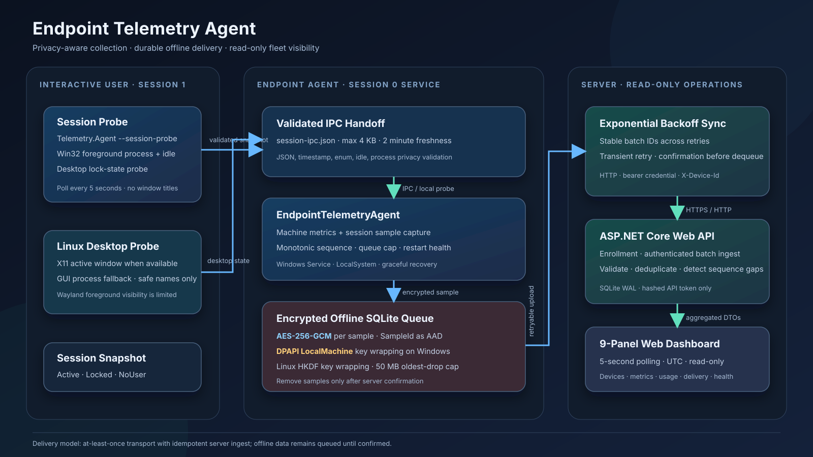

# Endpoint Telemetry Agent

A .NET Worker Service collects host CPU/memory and privacy-filtered user-session telemetry, retains samples in an encrypted offline queue, and uploads batches to an ASP.NET Core API. The server persists and deduplicates samples in SQLite; a read-only dashboard presents fleet health, delivery, session, and app-usage summaries.

> **Scope:** This repository implements the assignment's Phases 1–5. The Linux path is intended for development and demonstrations. Windows Session 0 / Session 1 integration is implemented but must be exercised on a Windows desktop before production deployment.

## Architecture



The agent uses at-least-once HTTP delivery with idempotent server ingest. Locally queued samples remain until the server confirms their sample IDs. This is not a distributed exactly-once transaction.

## Prerequisites

- .NET 8 SDK, or a later stable .NET SDK such as .NET 10. The root [global.json](global.json) requests SDK `8.0.127` and uses `rollForward: latestMajor`, so an installed later major SDK can be selected. The projects target `net8.0`; installing .NET 10 runtime alone is not a replacement for the SDK when building.
- Windows service deployment: Windows 10 22H2 or Windows 11 x64, elevated PowerShell for install/uninstall, and a logged-in interactive user for the session-probe scheduled task.
- Linux development/demo: Linux x64, `curl`, `python3`, and a .NET SDK. For X11 foreground-window lookup, install `xdotool`; GNOME lock-state detection optionally uses `gdbus`. Wayland may not expose the active application to this process.
- PowerShell 7 or Windows PowerShell for `.ps1` scripts.

## Build, test, run

Run these commands from the repository root:

```bash
dotnet restore EndpointTelemetry.sln
dotnet build EndpointTelemetry.sln -nologo -p:CheckEolTargetFramework=false
dotnet test EndpointTelemetry.sln -nologo
```

The solution targets .NET 8. On the Windows 11 QA machine with .NET SDK 8.0.427, restore succeeded, the solution built with **0 warnings and 0 errors**, and all **24 tests passed** after the latest telemetry and dashboard corrections. The current Windows quick-start steps are in [RUN_WINDOWS.md](RUN_WINDOWS.md).

Run the server:

```bash
dotnet run --project src/Telemetry.Server/Telemetry.Server.csproj -- --urls http://localhost:5080
```

Open the dashboard at <http://localhost:5080/>. API health is at <http://localhost:5080/api/v1/health>; in Development, Swagger UI is at <http://localhost:5080/swagger>.

Start a local live demo:

```bash
# Linux shell
./scripts/run-demo.sh

# PowerShell
./scripts/run-demo.ps1
```

The demo starts the server and agent with a five-second sampling interval. Logs are written to `logs/`; demo data is stored under `data/demo/`. Stop with Ctrl+C. The Linux script needs executable permission, which is already set in the repository.

The server defaults to `http://localhost:5080`; `AgentOptions:ServerBaseUrl` controls the agent endpoint. Agent settings are read from the `AgentOptions` configuration section and can be overridden with command-line configuration keys, for example `--AgentOptions:SampleIntervalSeconds=5`. Server settings use `ServerOptions`. Database/data directory defaults are relative to the process working directory, so deployments and scripts should set explicit writable directories.

## Windows Service install and removal

Run from an elevated PowerShell session in the repository:

```powershell
.\scripts\install-service.ps1
.\scripts\uninstall-service.ps1
```

Optional installer parameters include `-InstallDirectory`, `-DataDirectory`, and `-ServerUrl`. The default agent database/key/session-file location is `%ProgramData%\EndpointTelemetryAgent\data`. The uninstaller removes the Windows service, scheduled task, and program files, but intentionally preserves that data directory.

The installer publishes a framework-dependent `win-x64` agent, creates the `EndpointTelemetryAgent` service as `LocalSystem`, sets automatic restart recovery, and registers a per-user AtLogOn scheduled task to run `Telemetry.Agent.exe --session-probe`. The task and service use the same `DataDirectory`; the installer grants the current user modify access and `SYSTEM` full access to it.

### Why LocalSystem and a user-session probe?

A Windows service runs in Session 0, isolated from the interactive desktop. `GetForegroundWindow`/`GetLastInputInfo` in Session 0 cannot reliably describe a user's Session 1 desktop. The service therefore consumes a small JSON snapshot from the interactive user's probe task. The probe reads process executable names and product names, never window titles. The service validates message size, enum values, timestamp skew, idle values, and process-name privacy before accepting the message.

The service also queries the active console session through WTS when no fresh probe exists; the session probe refreshes every five seconds, and a file older than two minutes is ignored. The service then falls back to native/session process status rather than trusting stale IPC. LocalSystem is used for reliable service operation and local-machine DPAPI protection; it is highly privileged, so the agent does not expose a listening endpoint and the IPC data directory must remain restricted. The session JSON contains session state and application/process identity, so local access should be limited to the service and intended interactive user.

Run the probe manually for troubleshooting:

```powershell
Telemetry.Agent.exe --session-probe --AgentOptions:DataDirectory="C:\ProgramData\EndpointTelemetryAgent\data"
```

For a source-tree run, add the same switch after `dotnet run`'s argument separator: `dotnet run --project src/Telemetry.Agent/Telemetry.Agent.csproj -- --session-probe --AgentOptions:DataDirectory=/path/to/agent-data`.

### Linux desktop behavior

When `DISPLAY`, `WAYLAND_DISPLAY`, or `XDG_SESSION_TYPE` indicates a desktop (or a non-root interactive user is running), the collector reports an active session unless GNOME's optional `gdbus` screen-saver query reports a lock. X11 can provide a foreground process via `xdotool`; other environments use a safe-name-only shortlist of running GUI/developer processes. No window title is collected. The Linux idle value is a heuristic (`5` seconds with a recognized app, `25` otherwise), **not a measured last-input counter**. For headless environments with no desktop markers, state is `NoUser`.

## Data protection and delivery

- Each offline sample payload is encrypted at rest using AES-256-GCM, with an independent random nonce and the sample's `SampleId` as associated authenticated data.
- The master key is wrapped with Windows DPAPI `LocalMachine` on Windows. The Linux development implementation derives a wrapping key using HKDF and restricts the key file to owner read/write (`0600`).
- API tokens are protected in the agent store. The server stores only a SHA-256 token hash and compares hashed credentials in constant time; plaintext tokens are not written to server logs or the server database.
- The agent queue defaults to a 50 MB limit. If the cap is reached, it removes oldest queued samples first and accumulates a dropped-sample count for a future upload.
- Sync retries transient HTTP/network/timeout outcomes with exponential backoff and jitter. A retry in one cycle reuses the same batch. The agent removes only server-confirmed sample IDs; if a response is lost after the server commits, a later retry is deduplicated.
- Delivery is **at least once**, with idempotent storage on the server. It cannot guarantee that every measurement reaches the server if the local disk is lost, the queue cap evicts old samples, or the agent is unavailable.

## API

All API paths are rooted at `/api/v1`. JSON uses camelCase fields and string session enums.

### Enroll a device

`POST /api/v1/devices/enroll`

```json
{
  "deviceName": "demo-endpoint",
  "machineGuid": "machine-guid-value",
  "osVersion": "Windows 11",
  "agentVersion": "1.0.0"
}
```

Success (`200 OK`; the API token is returned at enrollment and should be treated as a secret):

```json
{
  "deviceId": "dev-0123456789abcdef",
  "apiToken": "one-time-base64url-token",
  "enrolledAtUtc": "2026-10-30T04:00:00+00:00"
}
```

### Upload telemetry

`POST /api/v1/telemetry/batch` requires `X-Device-Id` and `Authorization: Bearer <apiToken>`.

```json
{
  "deviceId": "dev-0123456789abcdef",
  "droppedSamplesCount": 0,
  "samples": [
    {
      "sampleId": "11111111-1111-4111-8111-111111111111",
      "capturedAtUtc": "2026-10-30T04:00:00+00:00",
      "cpuPercent": 12.5,
      "memoryUsedMb": 4096,
      "sessionState": "Active",
      "idleSeconds": 12,
      "foregroundProcess": "notepad.exe",
      "foregroundAppName": "Notepad",
      "agentVersion": "1.0.0",
      "sequenceNumber": 1,
      "agentStartedAtUtc": "2026-10-30T03:55:00+00:00",
      "queueDepth": 1
    }
  ]
}
```

Success (`200 OK`):

```json
{
  "storedCount": 1,
  "duplicateCount": 0,
  "confirmedSampleIds": ["11111111-1111-4111-8111-111111111111"],
  "serverReceivedAtUtc": "2026-10-30T04:00:01+00:00"
}
```

Malformed/invalid batch requests return `400`; missing/invalid credentials return `401`; bodies larger than the configured maximum (1 MiB by default) return `413`. Error responses use Problem Details. Rejected requests are recorded without logging authorization values.

### Dashboard overview

`GET /api/v1/dashboard/overview?deviceId=<optional>&range=1h`

`range` accepts `1h`, `8h`, or `24h`; unknown values use `1h`. Response is a `DashboardOverviewDto` containing `deviceStatus`, `recentSamples`, `cpuHistory`, `sessionBands`, `appUsageSummary`, `missingSampleGaps`, `deliveryStats`, `rejectedRequests`, and `agentHealth`. The exact shared DTO definitions are in [DashboardContracts.cs](src/Telemetry.Shared/DashboardContracts.cs).

### Health

`GET /api/v1/health` returns `200 OK`:

```json
{ "status": "ok" }
```

Request examples for every endpoint, including an unauthenticated rejection, are in [Telemetry.Server.http](src/Telemetry.Server/Telemetry.Server.http).

## Dashboard calculation notes

The read-only dashboard polls every five seconds and presents times in UTC. It displays process/friendly app names only; it does not collect or render window titles.

1. **Devices:** last-seen age is Online through 90 seconds, Stale through five minutes, and Offline afterward.
2. **Latest sample:** most recent sample in the selected range, including CPU, memory, session, idle, foreground app, and capture time.
3. **CPU and memory:** stored sample points for the selected 1h/8h/24h range.
4. **Session timeline:** chronological adjacent samples with the same session state are grouped into bands.
5. **App usage:** active, idle, locked, and no-user durations are estimated from observed sample timestamps using a typical positive sample interval, capped to avoid crediting long gaps; process grouping is case-insensitive. Idle means `IdleSeconds > 300` by default. Locked and no-user intervals are not credited to an app.
6. **Samples:** persisted samples for the selected device/range, ordered newest first in the UI.
7. **Delivery:** server totals count unique stored rows; repeated deliveries increment duplicates, not stored sample count. Sequence gaps are absent ranges between stored sequence numbers and shrink/disappear on backfill. Drop and batch counters come from accepted batch metadata.
8. **Rejected requests:** most recent audited request failures with timestamp, endpoint, HTTP status, and safe reason.
9. **Agent health:** latest agent-start timestamp, restart count, reported queue depth, and last successful sync time.

App/session duration is an estimate based on sample intervals, not a continuous stopwatch. Irregular or missing samples reduce precision; elapsed time is capped to the typical observed interval so a long gap is not presented as continuous activity. Top-app time is credited only to foreground samples with a safe process name.

## Windows verification

On October 31, 2026, the agent was run interactively on Windows 11 Pro (x64) with a five-second sampling interval and delivered live samples to the dashboard. Windows CPU counter deltas and `GlobalMemoryStatusEx` physical-memory readings changed across samples; the server accepted and persisted samples and the dashboard refreshed with current values. Observed session state was Active, and Chrome/VS Code foreground process names appeared in collected samples. A controlled Win+L lock/unlock cycle and Notepad/File Explorer switching were **not verified** in that run; do not treat those specific transitions as runtime-certified. The automated test suite contains 24 passing tests, but automated tests do not replace those desktop checks.

## Live reliability scenarios

Build the solution first, then run one of:

```bash
./scripts/run-5-scenarios.sh
```

```powershell
.\scripts\run-5-scenarios.ps1
```

The scripts start a local server and agent on `http://localhost:5080`, use an isolated temporary data directory by default, and leave the processes running so the dashboard can be inspected. Press Ctrl+C to stop and clean up temporary scenario data. An optional `TELEMETRY_SCENARIO_DATA` (shell) or `-DataDirectory` (PowerShell) retains data for later inspection. Both scripts require the solution to have been built and that port 5080 is available.

1. **Offline, restart, recover:** enroll while online, stop the server while the agent continues sampling, restart the agent while offline, then bring the same server database back. Queued sequence numbers backfill on reconnection.
2. **Duplicate delivery:** create a separate demo device, POST the exact same authenticated batch twice, and observe `DuplicatesIgnored` increase without duplicating samples/app time.
3. **Lock and unlock:** atomically write valid locked snapshots for several sample cycles, then active snapshots. Inspect the amber Locked band followed by Active and the corresponding usage split.
4. **Process failure:** stop and restart the agent process after its start time has advanced. The next upload updates restart health while the persistent queue and sequence numbers remain intact.
5. **Bad input:** send malformed JSON with valid demo credentials (`400`), an over-1-MiB payload (`413`), and a request without valid credentials (`401`). Inspect the rejected-request panel.

Active session data appears after the first sample. On Linux, run as a desktop user; X11 active-app identification is best-effort and needs `xdotool`. For Windows, install the service plus the scheduled session probe, or run the agent interactively. To observe Scenario 3, keep the agent using the same data directory as the snapshot writer.

The scenario runner accepts `TELEMETRY_SERVER_URL` and `TELEMETRY_SCENARIO_DATA` environment variables on Linux, or `-ServerUrl` and `-DataDirectory` in PowerShell. This permits testing on an alternate free port without disturbing another local server.

The Linux scenario runner was executed end-to-end during implementation on `http://127.0.0.1:5188` because another process already occupied port 5080. It returned the expected `400`, `413`, and `401` responses; database inspection confirmed duplicate accounting, locked samples, an empty agent queue after recovery, and no remaining sequence gaps.

| Script | Purpose |
|---|---|
| `scripts/run-demo.sh` / `.ps1` | Start a server and five-second agent for a live dashboard demo. |
| `scripts/run-5-scenarios.sh` / `.ps1` | Trigger the five reliability scenarios and leave the dashboard available until stopped. |
| `scripts/install-service.ps1` | Publish/install the Windows Service and current-user IPC probe task. |
| `scripts/uninstall-service.ps1` | Remove service/task/program files while preserving telemetry data. |
| `scripts/measure-footprint.sh` / `.ps1` | Publish and measure CPU, peak memory, and installed size. |

## Footprint measurement

Footprint scripts publish the agent and sample it while it sends telemetry to a local test server:

```bash
./scripts/measure-footprint.sh --seconds 30
```

```powershell
.\scripts\measure-footprint.ps1 -Seconds 30
```

The default duration is 30 minutes. Linux measurement uses 1-second `/proc/<pid>/stat` samples and reports logical-CPU-normalized average CPU, peak RSS, and total published directory size. Windows measurement samples process CPU and peak working set and reports the published directory size. The demo measurement is local and should not be treated as a production capacity benchmark.

**Measured in this implementation session:** on the current Linux x86_64 host (kernel `6.19.14-108.fc42.x86_64`, 12 logical CPUs, .NET SDK 8.0.127), a 30-second Release `linux-x64` framework-dependent run reported **4.65 MB published install size**, **0.44% average agent CPU** (normalized by logical CPU count), and **80.81 MB peak RSS**. The measurement used the local test server and one-second process samples; it is a short smoke measurement, not a production benchmark. Windows values and a 30-minute measurement were not collected. Run the scripts on target hardware before making a deployment SLO claim.

The current publishing strategy is framework-dependent (`--self-contained false`) to reduce package size and rely on a serviced .NET runtime. For managed fleets requiring a bundled runtime, publish self-contained and compare the resulting size and patching burden. Windows install publishes `win-x64`; the footprint helper publishes for the host runtime.

## Third-party NuGet packages

| Package (version) | Project | Purpose |
|---|---|---|
| `Microsoft.Data.Sqlite` (10.0.14) | Agent, Server | SQLite database provider for durable encrypted queue metadata and server telemetry. |
| `Microsoft.Extensions.Hosting.WindowsServices` (10.0.14) | Agent | Windows Service integration for the .NET Worker host. |
| `System.Diagnostics.PerformanceCounter` (10.0.14) | Agent | Windows performance-counter support dependency for agent metrics integrations. |
| `System.Security.Cryptography.ProtectedData` (10.0.14) | Agent | Windows DPAPI API for wrapping the agent master key. |
| `Microsoft.AspNetCore.OpenApi` (8.0.27) | Server | ASP.NET Core endpoint OpenAPI support. |
| `Swashbuckle.AspNetCore` (6.6.2) | Server | Swagger generation and interactive API documentation for this .NET 8 application. |
| `Microsoft.NET.Test.Sdk` (17.6.0) | Tests | Test discovery/execution infrastructure. |
| `xunit` (2.4.2) | Tests | Unit testing framework. |
| `xunit.runner.visualstudio` (2.4.5) | Tests | xUnit adapter for `dotnet test`. |
| `coverlet.collector` (6.0.0) | Tests | Optional coverage collection when requested. |

The .NET runtime, ASP.NET Core shared framework, and `System.Text.Json` are platform/framework components rather than standalone NuGet dependencies.

## Section 5 — Design notes and production considerations

1. **Packaging, signing, updates:** publish signed, versioned artifacts through a controlled release pipeline; verify signatures before installation. Use an enterprise deployment mechanism for staged rollout, rollback, and service/task updates. Add an explicit updater only with signed manifests, anti-rollback policy, and least-privilege installation.
2. **Scaling to 5,000 agents:** at one sample per minute the average ingest rate is about 84 samples/second, but synchronized startup/reconnect can create bursts. Add server-side batching/rate limits, connection pooling, indexes and retention/partition strategy, database backup/restore, metrics/alerts, and load tests. A single SQLite file is suitable for a compact deployment, not a highly available multi-node ingest tier; move to a managed relational store or partitioned ingest service when write concurrency/availability requirements exceed it.
3. **Delivery guarantee and limits:** local durable queue plus retry and server idempotency provides at-least-once delivery for retained samples. It is not end-to-end exactly-once and cannot recover data lost with disk failure, cap eviction, credential loss, or permanent validation rejection. Server confirmation is per sample ID; retry batches are stable within a sync cycle.
4. **Known limitations and next steps:** validate Windows WTS structure behavior and service/task ACLs on supported Windows builds; add integration tests on Windows and GNOME/X11/Wayland; replace Linux idle estimates with desktop-specific idle-time APIs; consider a named pipe with ACLs instead of shared-file IPC; add API rate limiting, token rotation/revocation, database retention and backup, TLS enforcement/certificate policy, audit log retention, packaging/signing automation, and load/chaos tests. Review foreground-process collection and user notice/consent against organizational privacy policy before rollout.
